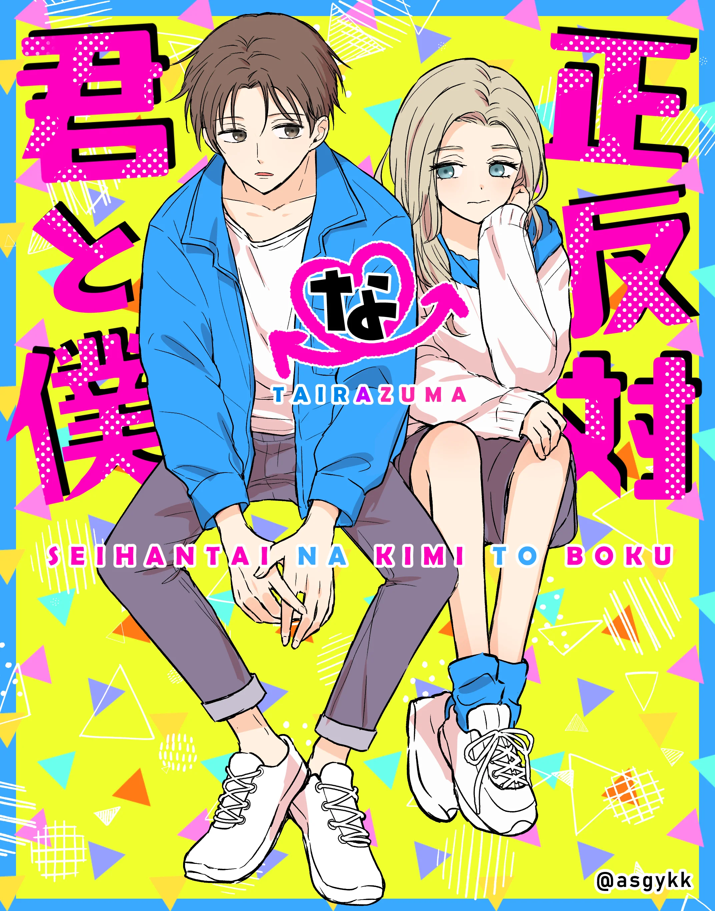
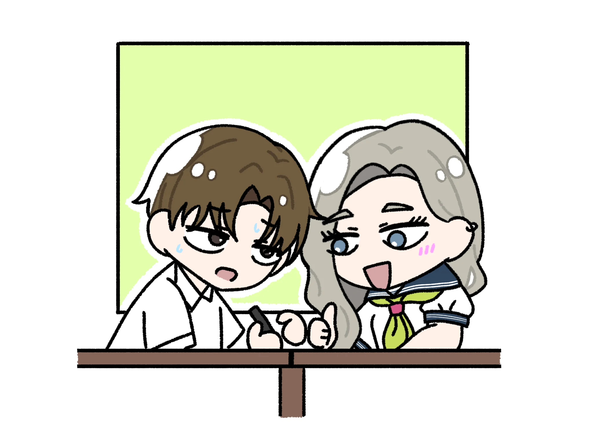
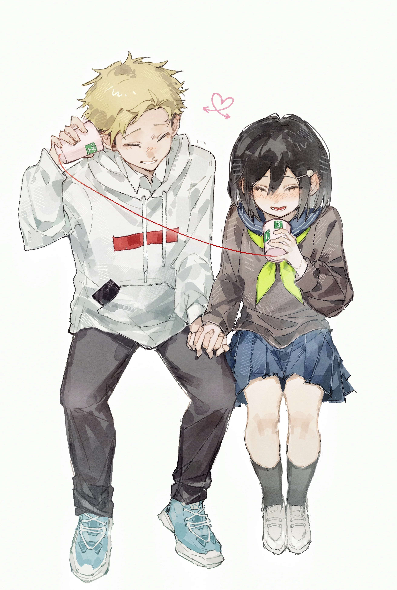
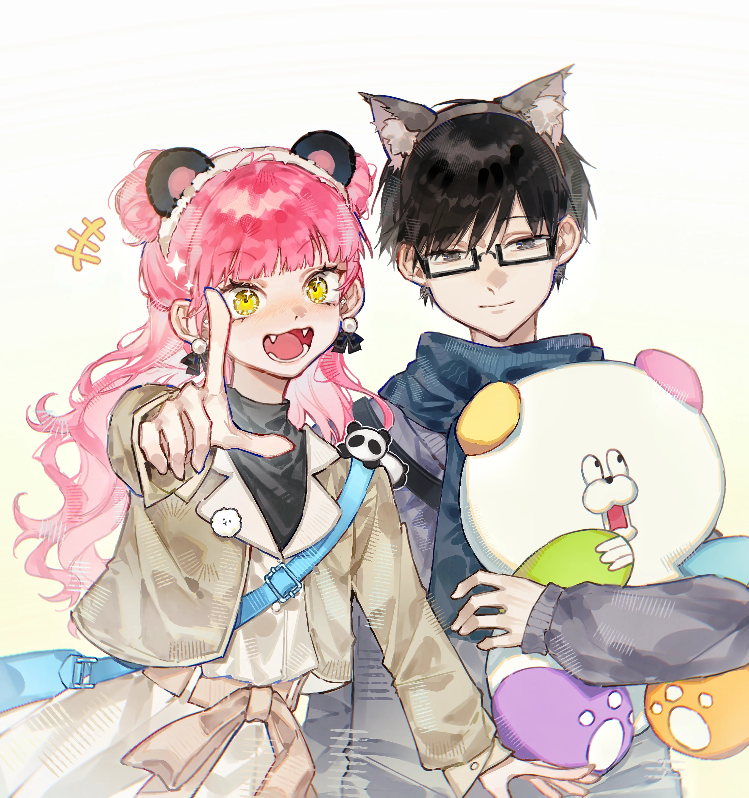

今天看了《正相反的你和我》，看完啦，好开心！ 🎉

很喜欢这种**纯甜也并非无脑**的小甜剧，很喜欢片头曲，喜欢节奏，喜欢氛围！

## 关于画风

虽然说男女主画的真不算好看，整体画风很独特，但是**不影响磕糖**！

## 最喜欢的角色

- **平和东**：感觉平很帅，但是太沉重了！！！东也很有感觉！

118747721_p0

146395119_p0

- **小西**：超可爱，害羞，内心戏也很多，整个剧就是很欢乐！

144198831_p0

可惜只有 12 集，而且我最想磕的都还没开始交往，唉……

## 为什么这部番不让人难受

男女主虽然害羞很多，但是这部剧就好在**该主动的时候会有人主动**！所以不会难受！

女主俏皮的蛮好玩的，一开始其实我对女主第一印象并不好，因为太在意别人，会感觉好做作，而且画的不好看，好多丑丑的表情，不过到后来，整体感觉还不错，就原谅这点啦！

144174454_p0

## 有趣的片段

里面有很多有趣的片段，剧情结构也很有特色，让人回味！比如山田的介绍确实交给旁白感觉会好很多，他太直了，像一块白板，很多事还是应当有说明，西西超内向的样子遇到他也很好玩。

---

正相反的你和我，很有让人眼前一亮的感觉呀！ ✨
